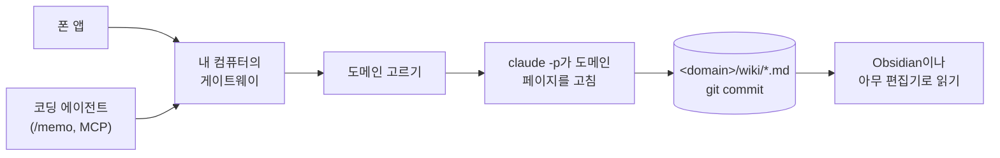

<p align="center">
  
</p>

<h1 align="center">dotoriwiki</h1>

<p align="center">
  <strong>메모를 남기면 Claude가 Markdown 위키에 정리합니다.</strong>
</p>

<p align="center">
  휴대폰이나 코딩 에이전트에서 메모를 보낼 수 있습니다. 내 컴퓨터에서 실행하는 게이트웨이가 Claude Code로 메모를 Markdown 위키에 정리하고, 변경 내용을 git에 커밋합니다.
</p>

<p align="center">
  <a href="LICENSE"></a>
  
  
  
</p>

<p align="center">
  <a href="#빠른-시작">빠른 시작</a> ·
  <a href="#동작-방식">동작 방식</a> ·
  <a href="docs/cli.md">문서</a> ·
  <a href="README.md">English</a>
</p>

---

## 소개

떠오른 생각이나 링크, 일하면서 배운 내용을 나중에 다시 찾아보려고 만들었습니다. 메모 앱에 적어 두기는 쉬웠지만, 다시 찾을 수 있게 정리하는 데는 손이 갔습니다.

dotoriwiki는 Claude Code로 메모를 위키에 정리하고 기존 페이지와 연결합니다. 처리에는 보통 1~2분이 걸립니다. 변경 내용은 git에 남아 확인하거나 되돌릴 수 있습니다. 위키는 컴퓨터에 Markdown 파일로 저장되므로 dotoriwiki 없이도 열어 볼 수 있습니다.

이름은 다람쥐가 나중에 먹으려고 모아 두는 도토리에서 따왔습니다.

## 주요 기능

- **오프라인 메모.** Android 앱을 열면 바로 메모를 입력할 수 있습니다. 메모는 전송 전에 휴대폰에 저장되며, 연결이 복구되면 보낼 수 있습니다. 사진의 EXIF를 보존하고, 영상 링크에서는 자막을 가져옵니다.
- **자동 분류와 정리.** 메모를 `일상`이나 `스터디` 같은 도메인으로 분류한 뒤, `claude -p`로 해당 도메인의 페이지를 수정합니다. 분류가 불확실하면 앱에서 확인할 때까지 보류합니다.
- **Git 이력.** 메모마다 커밋을 만들고, 도메인별 `wiki/log.md`에 처리 기록을 남깁니다. 페이지를 직접 수정한 경우에는 게이트웨이가 그 변경부터 커밋합니다.
- **Markdown과 Obsidian.** 위키 폴더를 Obsidian 보관함으로 열거나 다른 편집기로 읽을 수 있습니다. 게이트웨이는 자동으로 push하지 않습니다.
- **로컬 게이트웨이.** 내 컴퓨터에서 실행하며, Tailscale 주소로 접속해 토큰으로 인증합니다. dotoriwiki가 별도로 운영하는 서버는 없습니다.
- **MCP 연동.** Claude Code에서 `/memo`로 메모를 보내면 프로젝트와 git 브랜치도 함께 기록됩니다.
- **위키 설정.** `dotoriwiki.yaml`에서 도메인, 페이지 종류, 언어를 설정합니다. 저장하면 재시작 없이 적용됩니다. 초기 프리셋은 영어와 한국어를 지원합니다.

## 동작 방식



게이트웨이는 메모를 `inbox/`에 저장한 뒤 응답하므로, 실행 중에 종료되더라도 메모가 남습니다. 같은 도메인의 메모는 순서대로 처리하고, 서로 다른 도메인은 병렬로 처리합니다. 페이지 수정은 최대 세 번 시도하며, 각 시도를 처리 기록에 남깁니다.

## 필요한 것

- 계속 켜 둘 수 있는 Mac 또는 systemd를 사용하는 Linux 컴퓨터. 게이트웨이는 사용자 서비스로 실행됩니다.
- Node 24.22 이상. `npm install -g`가 `sudo` 없이 되도록 설치합니다. macOS는 Homebrew, 그 밖에는 nvm 같은 버전 관리자를 씁니다. `npm install -g`가 `EACCES`로 실패하면 npm 안내서 [Resolving EACCES permissions errors](https://docs.npmjs.com/resolving-eacces-permissions-errors-when-installing-packages-globally)를 따릅니다.
- git.
- Claude Code. `claude`로 한 번 로그인해 둡니다. Anthropic API 키를 사용할 수도 있습니다. [비용](#비용)을 보세요.
- 폰으로 쓰려면 Android 폰, 그리고 폰과 컴퓨터 양쪽에 같은 tailnet으로 로그인한 Tailscale. Tailscale이 없으면 게이트웨이는 그 컴퓨터 안에서만 응답합니다.
- 선택: `yt-dlp`가 있으면 영상 링크의 자막을 붙입니다. 사진 처리는 `sips`로 크기를 줄이기 때문에 macOS가 필요합니다. 텍스트 메모는 Linux에서도 지원합니다.

## 빠른 시작

아래 순서대로 설치하면 `~/wiki`에 위키가 만들어집니다.

1. `dotoriwiki` 명령을 설치합니다.

   ```sh
   npm install -g https://github.com/hseunghwan/dotoriwiki/releases/latest/download/dotoriwiki.tgz
   ```

   최신 릴리스에 첨부된 패키지를 설치합니다. 소스에서 설치하려면 이렇게 합니다.

   ```sh
   git clone https://github.com/hseunghwan/dotoriwiki.git
   cd dotoriwiki
   npm ci
   npm pack
   npm install -g ./dotoriwiki-*.tgz
   cd ..
   ```

2. 위키를 만듭니다.

   ```sh
   dotoriwiki init ~/wiki
   ```

   `init`은 도메인 세 개가 든 프리셋을 복사하고 커밋합니다. `LANG`이 `ko`로 시작하면 한국어 프리셋, 아니면 영어 프리셋입니다. `--locale ko`나 `--locale en`으로 고를 수도 있습니다. 컴퓨터 설정과 무작위로 생성한 토큰은 `~/.config/dotoriwiki/gateway.env`에 저장합니다.

3. 컴퓨터를 점검합니다.

   ```sh
   dotoriwiki doctor
   ```

   마지막 줄에 `Ready.`가 나오면 준비가 끝난 것입니다. `warn`은 경고이며, `fail`에는 해결 방법이 함께 나옵니다.

4. 게이트웨이를 서비스로 띄웁니다. 폰으로 쓰려면 Tailscale을 먼저 켭니다.

   ```sh
   dotoriwiki install
   ```

   마지막 몇 줄에 게이트웨이가 응답하는 주소가 나옵니다. `http://100.101.102.103:8787` 같은 주소입니다. 서비스는 로그인할 때 다시 시작하고, Linux에서는 부팅할 때도 시작합니다. Tailscale이 없으면 `http://127.0.0.1:8787`에서만 접속할 수 있으며, 설치 결과에도 이 주소가 표시됩니다.

5. 폰을 연결합니다. 폰에 Tailscale을 설치하고 같은 tailnet으로 로그인합니다. 이 저장소의 Releases 페이지에서 최신 릴리스의 APK를 받아 폰에서 엽니다. Android에서 설치 권한을 요청하면 허용합니다. APK를 직접 빌드하려면 [docs/spec-app.md](docs/spec-app.md)를 따릅니다. 그다음 QR을 띄우고 앱 첫 화면에서 스캔합니다.

   ```sh
   dotoriwiki pair
   ```

6. 앱에서 메모를 작성해 전송합니다. 휴대폰 없이 테스트하려면 컴퓨터에서 `curl`로 보낼 수 있습니다.

   ```sh
   . ~/.config/dotoriwiki/gateway.env
   node -e 'console.log(JSON.stringify({ id: crypto.randomUUID(), text: process.argv[1], captured_at: new Date().toISOString(), tz: Intl.DateTimeFormat().resolvedOptions().timeZone, source: "typed" }))' \
     '오늘 pgvector를 써 봤다. HNSW 인덱스를 거니 전체 스캔보다 검색이 훨씬 빨랐다.' |
     curl -sS "http://$HOST:$PORT/memos" -H "Authorization: Bearer $GATEWAY_TOKEN" -H 'Content-Type: application/json' --data-binary @-
   ```

   게이트웨이가 `{"id":"…","status":"accepted"}`로 답합니다. 이 응답을 받으면 메모가 디스크에 저장된 상태입니다.

7. 처리 상태를 확인합니다. 메모 하나를 정리하는 데 보통 1~2분이 걸립니다. 앱의 기록 탭이나 아래 명령으로 확인할 수 있습니다.

   ```sh
   curl -sS "http://$HOST:$PORT/status" -H "Authorization: Bearer $GATEWAY_TOKEN"
   ```

   `inbox`가 `0`이고 모든 도메인의 `pending`이 `0`, `running`이 `null`이면 정리가 끝난 것입니다. `held`가 `1`이면 분류가 불확실해 보류된 메모가 있으므로 앱에서 확인해야 합니다. 그 도메인의 `wiki/log.md`에 메모 한 줄이 생기고, git에 커밋이 하나 생깁니다.

   ```sh
   tail -n 1 ~/wiki/*/wiki/log.md
   git -C ~/wiki log --oneline -3
   ```

8. Obsidian에서 위키를 엽니다. **폴더를 보관함으로 열기**를 고르고 `~/wiki`를 선택합니다. 새 페이지는 그 도메인의 `wiki/` 폴더에 있습니다.

## 코딩 에이전트에서 메모 보내기

게이트웨이는 같은 토큰으로 `/mcp`에서 MCP도 제공합니다. 도구는 `write_memo`와 `memo_status`입니다. MCP로 보낸 메모에는 프로젝트, 폴더, git 브랜치가 함께 기록됩니다.

Claude Code에서는 이 저장소의 플러그인을 설치합니다. 플러그인을 설치하면 MCP 서버와 `/memo` 명령이 추가됩니다.

```sh
claude plugin marketplace add hseunghwan/dotoriwiki
claude plugin install dotoriwiki@dotoriwiki
```

게이트웨이 컴퓨터에서 `dotoriwiki pair --show-token`을 실행하면 주소와 토큰이 나옵니다. Claude Code에서 `/plugin configure dotoriwiki@dotoriwiki`를 실행하고 주소와 토큰을 입력합니다. 그다음 `/memo <내용>`을 입력합니다.

플러그인 없이 쓰려면 이 주소를 원격 MCP 서버로 등록합니다. Claude Code에서는 이렇게 합니다.

```sh
claude mcp add --transport http dotoriwiki http://<address>:8787/mcp --header "Authorization: Bearer <token>"
```

## 파일 위치

| 무엇 | 어디 |
| --- | --- |
| `dotoriwiki` 명령 | npm 전역 폴더 (`npm root -g`) |
| 내 위키 | `init`에 준 폴더. git 저장소이자 Obsidian 보관함입니다. |
| 이 컴퓨터의 설정 | `~/.config/dotoriwiki/gateway.env` (포트, 주소, 토큰, 프로그램 경로, 결제 방식), 선택 사항인 `models.json` |
| 앱 채팅 기록 | `~/.local/share/dotoriwiki/chats` |
| 게이트웨이 로그 | macOS는 `~/Library/Logs/dotoriwiki.log`, Linux는 `journalctl --user -u dotoriwiki.service` |

각 도메인은 별도 폴더로 나뉘며, 폴더 안의 `CLAUDE.md`에 도메인의 용도를 적습니다. 메모는 `<domain>/raw/`에, 페이지는 `<domain>/wiki/`에, 게이트웨이의 처리 기록은 `<domain>/wiki/log.md`에 쌓입니다. 루트의 `dotoriwiki.yaml`에 도메인 목록과 위키 설정이 있습니다.

## 도메인과 설정 바꾸기

게이트웨이를 실행한 상태에서 `dotoriwiki.yaml`을 수정할 수 있습니다. 게이트웨이는 요청마다 이 파일을 읽기 때문에, 저장하면 재시작 없이 반영됩니다. 도메인을 더하려면 그 도메인을 설명하는 `CLAUDE.md`를 둔 폴더를 만들고 `domains` 아래에 항목을 추가합니다.

설정 파일에 오류가 있으면 정리를 중단합니다. 게이트웨이는 메모를 계속 받아 `inbox/`에 두고, 파일을 고치면 이어서 정리합니다. `GET /status`와 `dotoriwiki doctor`에서 문제가 있는 설정 키를 확인할 수 있습니다.

포트나 Claude 결제 계정 같은 컴퓨터 설정은 위키가 아니라 `gateway.env`에 있습니다. 모든 명령과 설정은 [docs/cli.md](docs/cli.md)에 있습니다.

## 게이트웨이가 커밋하는 것

게이트웨이는 위키의 git 저장소에 커밋만 하고 push하지 않습니다. 정리된 메모 하나가 커밋 하나이고, 그 커밋에 메모, `claude -p`가 바꾼 페이지, `log.md` 한 줄이 들어갑니다. 페이지나 `dotoriwiki.yaml`을 손으로 고치면, 게이트웨이가 그 도메인의 다음 작업 전에 `manual(...)`로 커밋합니다. 다른 곳에 사본을 두려면 직접 push합니다.

## 개인 정보

- 게이트웨이는 주소 하나에서만 요청을 받습니다. 컴퓨터의 Tailscale 주소이고, Tailscale이 없으면 `127.0.0.1`입니다. 모든 요청에 토큰이 필요합니다. 연결용 웹 페이지는 없습니다.
- 메모 내용은 내 Claude Code 계정이나 API 키를 사용해 `claude -p`를 통해 Claude로 전송됩니다.
- 메모 파일에는 폰이 함께 보낸 위치가 기록됩니다. 사진 원본은 EXIF와 함께 `_originals/`에 남고, 위키의 `.gitignore`가 이 폴더를 제외합니다. 게이트웨이가 커밋하는 2048 px 사본에도 GPS를 포함한 EXIF가 남습니다. 저장소를 push한다면 비공개로 두세요.
- 토큰과 API 키는 내 사용자만 읽을 수 있는 `gateway.env`에만 있습니다. 위키에는 들어가지 않습니다.

## 비용

메모 하나를 처리할 때 `claude -p`를 최소 두 번 실행합니다. 도메인을 고를 때 한 번(기본 Haiku), 페이지를 고칠 때 한 번(기본 Sonnet)입니다. 페이지 수정은 최대 세 번 시도합니다. 앱의 질문 탭에서는 대화할 때마다 한 번 더 실행합니다. 기본적으로 Claude Code에 로그인한 계정의 구독을 사용하며, 구독 사용 한도에 포함됩니다. `gateway.env`에 `CLAUDE_BILLING=api`와 `ANTHROPIC_API_KEY`를 넣으면 API 키를 사용하며 토큰 사용량에 따라 과금됩니다. 자세한 내용은 [docs/cli.md](docs/cli.md#who-pays-for-claude)에 있고, 모델은 `models.json`에서 변경할 수 있습니다.

## 관련 문서

- [docs/cli.md](docs/cli.md): 모든 명령, env 파일, 서비스.
- [docs/spec-app.md](docs/spec-app.md): Android 앱과 빌드 방법.
- [docs/spec-mcp.md](docs/spec-mcp.md): MCP 엔드포인트와 `/memo`.
- [docs/design/wiki-config.md](docs/design/wiki-config.md): `dotoriwiki.yaml` 구조와 설계 배경.
- [docs/plan.md](docs/plan.md): 개인용 도구를 배포 가능한 형태로 만드는 계획.
- [docs/from-llmwiki-app.md](docs/from-llmwiki-app.md): 이 프로젝트의 전신인 llmwiki-app과 달라진 점.

## 현재 상태

dotoriwiki는 0.1 버전입니다. 개인적으로 매일 쓰던 도구에서 시작했으며, 지금까지 메모 수백 개를 정리했습니다. 모바일 앱은 Android를 지원하며, 사진 처리는 Mac에서만 가능합니다. 1.0 전까지 설정 파일과 API는 바뀔 수 있습니다.

## 기여하기

이슈와 풀 리퀘스트를 환영합니다. 보내기 전에 이렇게 확인해 주세요.

```sh
npm ci
npm test
npm run check:private
```

`npm test`는 게이트웨이의 타입 검사와 테스트를 실행합니다. 앱 테스트는 `app/`에서 `npm ci && npm test`로 실행합니다. `check:private`는 지정한 개인 정보 패턴과 일치하는 내용이 있으면 실패합니다. 커밋 전에 홈 경로나 실제 주소가 포함됐는지 확인하는 데 사용합니다. 패턴 목록은 저장소 밖 `~/.config/dotoriwiki/private-patterns`에 둡니다.

## 라이선스

MIT. [LICENSE](LICENSE)를 보세요.
