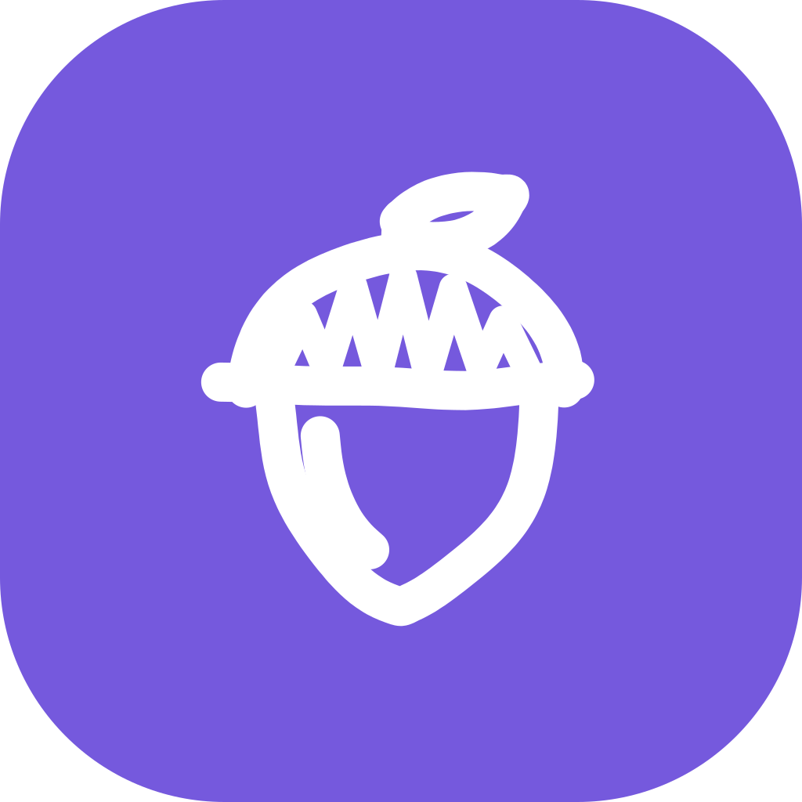
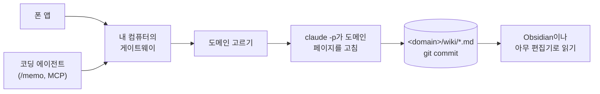

<p align="center">
  
</p>

<h1 align="center">dotoriwiki</h1>

<p align="center">
  <strong>2초 만에 적으면, Claude가 위키에 정리합니다.</strong>
</p>

<p align="center">
  폰과 코딩 에이전트에서 쓰는 메모 앱입니다. 내 컴퓨터에서 도는 게이트웨이가 메모를 읽고, Claude Code로 Markdown 위키에 정리한 다음, git에 커밋합니다.
</p>

<p align="center">
  <a href="LICENSE"></a>
  
  
  
</p>

<p align="center">
  <a href="#빠른-시작">빠른 시작</a> ·
  <a href="#동작-방식">동작 방식</a> ·
  <a href="docs/cli.md">문서</a> ·
  <a href="README.md">English</a>
</p>

---

## 왜 dotoriwiki인가

메모는 쌓이기만 합니다. 버스에서 떠오른 생각, 친구가 보내 준 링크, 회사에서 버그를 잡다 배운 것. 메모 앱에 들어간 뒤로 아무도 정리하지 않으니 다시 찾지 못합니다.

dotoriwiki가 그 정리를 대신합니다. 한 줄 적고 하던 일로 돌아가면 됩니다. 1~2분 안에 그 메모는 위키의 알맞은 자리에 페이지로 들어가고, 이미 써 둔 페이지와 링크로 이어집니다. 바뀐 내용은 git 커밋으로 남아 읽거나 되돌릴 수 있습니다. 위키는 내 디스크에 있는 평범한 Markdown이라, 어떤 앱이 사라져도 내 것으로 남습니다.

다람쥐는 도토리를 아무 데나 묻어 두고 겨울에 꺼내 먹습니다. 잊어버린 도토리는 참나무가 됩니다.

## 할 수 있는 것

- **적는 게 먼저.** Android 앱은 열면 바로 입력창입니다. 메모는 보내기 전에 폰에 먼저 저장되어서, 연결이 나빠도 잃지 않습니다. 사진은 EXIF를 그대로 지니고, 영상 링크에는 자막이 붙습니다.
- **정리는 알아서.** 분류기가 `일상`이나 `스터디` 같은 도메인을 고릅니다. 확신이 없으면 앱에서 내가 확인할 때까지 기다립니다. 그다음 `claude -p`가 그 도메인의 페이지를 고칩니다.
- **믿을 수 있는 기록.** 메모 하나가 git 커밋 하나입니다. 도메인마다 `wiki/log.md`에 장부를 남깁니다. 내가 페이지를 직접 고치면 게이트웨이가 그 수정부터 커밋합니다.
- **내가 가진 평범한 파일.** 위키는 Markdown 페이지가 든 폴더이고 그대로 Obsidian vault입니다. 게이트웨이는 위키를 어디에도 push하지 않습니다.
- **기본이 비공개.** 게이트웨이는 내 컴퓨터에서 돌고, 토큰을 가진 요청에만 내 Tailscale 주소로 답합니다. 클라우드 서비스가 없습니다.
- **코딩 에이전트도 씁니다.** 게이트웨이가 MCP를 제공합니다. Claude Code에서 `/memo`를 쓰면 어느 프로젝트, 어느 브랜치에서 쓴 메모인지 함께 남습니다.
- **규칙은 내가.** 도메인, 페이지 종류, 위키 언어는 `dotoriwiki.yaml`에 있습니다. 저장하면 재시작 없이 바로 적용됩니다. 위키는 영어나 한국어로 시작합니다.

## 동작 방식



게이트웨이는 응답하기 전에 메모를 `inbox/`에 먼저 씁니다. 그래서 게이트웨이가 죽어도 메모는 남습니다. 도메인마다 작업자가 하나라서 한 도메인을 두 메모가 동시에 고치는 일이 없고, 서로 다른 도메인은 나란히 처리됩니다. 고치기에 실패하면 세 번까지 다시 시도하고, 시도할 때마다 장부에 남습니다.

## 필요한 것

- 계속 켜 두는 Mac, 또는 systemd를 쓰는 Linux 컴퓨터. 게이트웨이는 그 컴퓨터에서 내 사용자의 서비스로 돕니다.
- Node 24.22 이상. `npm install -g`가 `sudo` 없이 되도록 설치합니다. macOS는 Homebrew, 그 밖에는 nvm 같은 버전 관리자를 씁니다. `npm install -g`가 `EACCES`로 실패하면 npm 안내서 [Resolving EACCES permissions errors](https://docs.npmjs.com/resolving-eacces-permissions-errors-when-installing-packages-globally)를 따릅니다.
- git.
- Claude Code. `claude`로 한 번 로그인해 둡니다. Anthropic API 키로도 됩니다. [비용](#비용)을 보세요.
- 폰으로 쓰려면 Android 폰, 그리고 폰과 컴퓨터 양쪽에 같은 tailnet으로 로그인한 Tailscale. Tailscale이 없으면 게이트웨이는 그 컴퓨터 안에서만 응답합니다.
- 선택: `yt-dlp`가 있으면 영상 링크의 자막을 붙입니다. 사진은 macOS에서만 됩니다. 게이트웨이가 `sips`로 사진을 줄이기 때문입니다. 글 메모는 Linux에서도 됩니다.

## 빠른 시작

10분쯤 걸립니다. 위키는 `~/wiki`에 만듭니다.

1. `dotoriwiki` 명령을 설치합니다.

   ```sh
   npm install -g https://github.com/hseunghwan/dotoriwiki/releases/latest/download/dotoriwiki.tgz
   ```

   최신 릴리스에 첨부된 패키지를 설치합니다. 소스에서 설치하려면 이렇게 합니다.

   ```sh
   git clone https://github.com/hseunghwan/dotoriwiki.git
   cd dotoriwiki
   npm ci
   npm pack
   npm install -g ./dotoriwiki-*.tgz
   cd ..
   ```

2. 위키를 만듭니다.

   ```sh
   dotoriwiki init ~/wiki
   ```

   `init`은 도메인 세 개가 든 프리셋을 복사하고 커밋합니다. `LANG`이 `ko`로 시작하면 한국어 프리셋, 아니면 영어 프리셋입니다. `--locale ko`나 `--locale en`으로 고를 수도 있습니다. 이 컴퓨터의 설정도 `~/.config/dotoriwiki/gateway.env`에 무작위 토큰과 함께 씁니다.

3. 컴퓨터를 점검합니다.

   ```sh
   dotoriwiki doctor
   ```

   마지막 줄이 `Ready.`면 됩니다. `warn` 줄은 실패가 아닙니다. `fail` 줄마다 고치는 방법이 함께 나옵니다.

4. 게이트웨이를 서비스로 띄웁니다. 폰으로 쓰려면 Tailscale을 먼저 켭니다.

   ```sh
   dotoriwiki install
   ```

   마지막 몇 줄에 게이트웨이가 응답하는 주소가 나옵니다. `http://100.101.102.103:8787` 같은 주소입니다. 서비스는 로그인할 때 다시 시작하고, Linux에서는 부팅할 때도 시작합니다. Tailscale이 없으면 `http://127.0.0.1:8787`에서 응답하고, `install`이 그렇다고 알려 줍니다.

5. 폰을 연결합니다. 폰에 Tailscale을 설치하고 같은 tailnet으로 로그인합니다. 이 저장소의 Releases 페이지에서 최신 릴리스의 APK를 받아 폰에서 엽니다. Android가 그 앱의 설치 허용을 물어봅니다. APK를 직접 빌드하려면 [docs/spec-app.md](docs/spec-app.md)를 따릅니다. 그다음 QR을 띄우고 앱 첫 화면에서 스캔합니다.

   ```sh
   dotoriwiki pair
   ```

6. 메모를 보냅니다. 앱에서 적고 보냅니다. 폰 없이 해 보려면 컴퓨터에서 `curl`로 보냅니다.

   ```sh
   . ~/.config/dotoriwiki/gateway.env
   node -e 'console.log(JSON.stringify({ id: crypto.randomUUID(), text: process.argv[1], captured_at: new Date().toISOString(), tz: Intl.DateTimeFormat().resolvedOptions().timeZone, source: "typed" }))' \
     '오늘 pgvector를 써 봤다. HNSW 인덱스를 거니 전체 스캔보다 검색이 훨씬 빨랐다.' |
     curl -sS "http://$HOST:$PORT/memos" -H "Authorization: Bearer $GATEWAY_TOKEN" -H 'Content-Type: application/json' --data-binary @-
   ```

   게이트웨이가 `{"id":"…","status":"accepted"}`로 답합니다. 이때부터 메모는 디스크에 안전하게 있습니다.

7. 정리되는 것을 봅니다. 메모 하나에 1~2분 걸립니다. 앱의 기록 탭에도 나오고, 게이트웨이 상태로도 봅니다.

   ```sh
   curl -sS "http://$HOST:$PORT/status" -H "Authorization: Bearer $GATEWAY_TOKEN"
   ```

   `inbox`가 `0`이고 모든 도메인의 `pending`이 `0`, `running`이 `null`이면 정리가 끝난 것입니다. `held`가 `1`이면 게이트웨이가 도메인을 확신하지 못한 것이고, 메모는 앱에서 확인해 줄 때까지 기다립니다. 그 도메인의 `wiki/log.md`에 메모 한 줄이 생기고, git에 커밋이 하나 생깁니다.

   ```sh
   tail -n 1 ~/wiki/*/wiki/log.md
   git -C ~/wiki log --oneline -3
   ```

8. Obsidian에서 위키를 엽니다. **폴더를 보관함으로 열기**를 고르고 `~/wiki`를 선택합니다. 새 페이지는 그 도메인의 `wiki/` 폴더에 있습니다.

## 코딩 에이전트에서 메모 보내기

게이트웨이는 같은 토큰으로 `/mcp`에서 MCP도 제공합니다. 도구는 `write_memo`와 `memo_status`입니다. 이 길로 보낸 메모에는 보낸 곳의 프로젝트, 폴더, git 브랜치가 함께 기록됩니다.

Claude Code에서는 이 저장소의 플러그인을 설치합니다. 플러그인은 MCP 서버와 `/memo` 명령을 더합니다.

```sh
claude plugin marketplace add hseunghwan/dotoriwiki
claude plugin install dotoriwiki@dotoriwiki
```

게이트웨이 컴퓨터에서 `dotoriwiki pair --show-token`을 실행하면 주소와 토큰이 나옵니다. Claude Code에서 `/plugin configure dotoriwiki@dotoriwiki`를 실행하고 둘을 넣습니다. 그다음 `/memo <내용>`을 입력합니다.

플러그인 없이 쓰려면 이 주소를 원격 MCP 서버로 등록합니다. Claude Code에서는 이렇게 합니다.

```sh
claude mcp add --transport http dotoriwiki http://<address>:8787/mcp --header "Authorization: Bearer <token>"
```

## 무엇이 어디에 있나

| 무엇 | 어디 |
| --- | --- |
| `dotoriwiki` 명령 | npm 전역 폴더 (`npm root -g`) |
| 내 위키 | `init`에 준 폴더. git 저장소이자 Obsidian 보관함입니다. |
| 이 컴퓨터의 설정 | `~/.config/dotoriwiki/gateway.env` (포트, 주소, 토큰, 프로그램 경로, 결제 방식), 그리고 있으면 `models.json` |
| 앱에서 한 질문 대화 | `~/.local/share/dotoriwiki/chats` |
| 게이트웨이 로그 | macOS는 `~/Library/Logs/dotoriwiki.log`, Linux는 `journalctl --user -u dotoriwiki.service` |

위키 안에서 도메인 하나는 폴더 하나입니다. 폴더의 `CLAUDE.md`가 모델에게 그 도메인이 무엇을 위한 곳인지 알려 줍니다. 메모는 `<domain>/raw/`에, 페이지는 `<domain>/wiki/`에, 게이트웨이의 처리 기록은 `<domain>/wiki/log.md`에 쌓입니다. 루트의 `dotoriwiki.yaml`에 도메인 목록과 위키 설정이 있습니다.

## 도메인과 설정 바꾸기

게이트웨이가 도는 중에 `dotoriwiki.yaml`을 고칩니다. 게이트웨이는 요청마다 이 파일을 읽기 때문에, 저장하면 재시작 없이 반영됩니다. 도메인을 더하려면 그 도메인을 설명하는 `CLAUDE.md`를 둔 폴더를 만들고 `domains` 아래에 항목을 더합니다.

파일에 실수가 있으면 정리가 멈춥니다. 게이트웨이는 메모를 계속 받아 `inbox/`에 두고, 파일을 고치면 이어서 정리합니다. `GET /status`와 `dotoriwiki doctor`가 문제마다 고칠 키를 알려 줍니다.

포트나 Claude 결제 계정 같은 컴퓨터 설정은 위키가 아니라 `gateway.env`에 있습니다. 모든 명령과 설정은 [docs/cli.md](docs/cli.md)에 있습니다.

## 게이트웨이가 커밋하는 것

게이트웨이는 위키의 git 저장소에 커밋만 하고 push하지 않습니다. 정리된 메모 하나가 커밋 하나이고, 그 커밋에 메모, `claude -p`가 바꾼 페이지, `log.md` 한 줄이 들어갑니다. 페이지나 `dotoriwiki.yaml`을 손으로 고치면, 게이트웨이가 그 도메인의 다음 작업 전에 `manual(...)`로 커밋합니다. 다른 곳에 사본을 두려면 직접 push합니다.

## 개인 정보

- 게이트웨이는 주소 하나에서만 요청을 받습니다. 컴퓨터의 Tailscale 주소이고, Tailscale이 없으면 `127.0.0.1`입니다. 모든 요청에 토큰이 필요합니다. 연결용 웹 페이지는 없습니다.
- 메모 내용은 `claude -p`를 거쳐 Claude로 갑니다. 내 Claude Code 계정이나 API 키로 갑니다.
- 메모 파일에는 폰이 함께 보낸 위치가 기록됩니다. 사진 원본은 EXIF와 함께 `_originals/`에 남고, 위키의 `.gitignore`가 이 폴더를 제외합니다. 게이트웨이가 커밋하는 2048 px 사본에도 GPS를 포함한 EXIF가 남습니다. 저장소를 push한다면 비공개로 두세요.
- 토큰과 API 키는 내 사용자만 읽을 수 있는 `gateway.env`에만 있습니다. 위키에는 들어가지 않습니다.

## 비용

메모 하나에 `claude -p`가 적어도 두 번 돕니다. 도메인을 고를 때 한 번(기본 Haiku), 페이지를 고칠 때 한 번(기본 Sonnet)입니다. 페이지 고치기가 실패하면 세 번까지 다시 시도합니다. 앱의 질문 탭은 대화 한 번마다 한 번 더 돕니다. 기본으로는 Claude Code가 로그인한 구독을 쓰고, 그 구독의 사용 한도에 포함됩니다. `gateway.env`에 `CLAUDE_BILLING=api`와 `ANTHROPIC_API_KEY`를 넣으면 대신 API 키로 토큰만큼 과금됩니다. 자세한 내용은 [docs/cli.md](docs/cli.md#who-pays-for-claude)에 있고, 다른 모델은 `models.json`으로 고릅니다.

## 더 읽을 것

- [docs/cli.md](docs/cli.md): 모든 명령, env 파일, 서비스.
- [docs/spec-app.md](docs/spec-app.md): Android 앱과 빌드 방법.
- [docs/spec-mcp.md](docs/spec-mcp.md): MCP 엔드포인트와 `/memo`.
- [docs/design/wiki-config.md](docs/design/wiki-config.md): `dotoriwiki.yaml`과 그렇게 생긴 이유.
- [docs/plan.md](docs/plan.md): 한 사람의 설정에서 이 릴리스까지의 계획.
- [docs/from-llmwiki-app.md](docs/from-llmwiki-app.md): 이 프로젝트의 전신인 llmwiki-app과 달라진 점.

## 현재 상태

dotoriwiki는 0.1 버전입니다. 한 사람이 매일 쓰던 설정에서 시작했고, 지금까지 메모 수백 개를 정리했습니다. 폰 앱은 Android만 있고, 사진은 Mac에서만 됩니다. 1.0 전까지 설정 파일과 API는 바뀔 수 있습니다.

## 기여하기

이슈와 풀 리퀘스트를 환영합니다. 보내기 전에 이렇게 확인해 주세요.

```sh
npm ci
npm test
npm run check:private
```

`npm test`는 게이트웨이를 타입 검사하고 테스트를 돌립니다. 앱 테스트는 `app/`에 따로 있습니다(거기서 `npm ci && npm test`). `check:private`는 파일이 내 개인 정보 패턴 목록에 걸리면 실패해서, 홈 경로나 실제 주소가 커밋에 들어가지 않게 막습니다. 패턴 목록은 저장소 밖 `~/.config/dotoriwiki/private-patterns`에 둡니다.

## 라이선스

MIT. [LICENSE](LICENSE)를 보세요.
