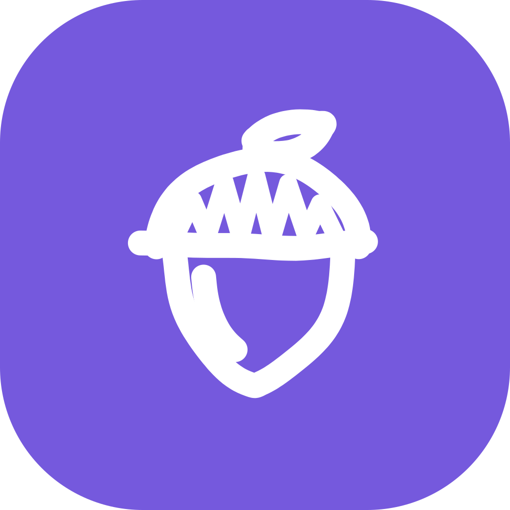
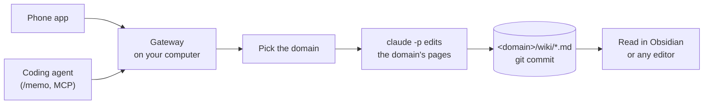

<p align="center">
  
</p>

<h1 align="center">dotoriwiki</h1>

<p align="center">
  <strong>Save a memo. Claude organizes it in your Markdown wiki.</strong>
</p>

<p align="center">
  Send memos from your phone or coding agent. A gateway running on your computer uses Claude Code to organize them in a Markdown wiki and commit the changes to git.
</p>

<p align="center">
  <a href="LICENSE"></a>
  
  
  
</p>

<p align="center">
  <a href="#quick-start">Quick start</a> ·
  <a href="#how-it-works">How it works</a> ·
  <a href="docs/cli.md">Docs</a> ·
  <a href="README.ko.md">한국어</a>
</p>

---

## About

I built dotoriwiki to keep track of thoughts, links, and things I learned while working. Saving them in a notes app was easy; organizing them so I could find them later took more effort.

dotoriwiki uses Claude Code to file each memo into a wiki and link it to existing pages. Processing usually takes a minute or two. Changes are recorded in git, so you can review or revert them. The wiki is stored as Markdown files on your computer and can be opened without dotoriwiki.

Dotori (도토리) means acorn in Korean. The name comes from squirrels storing acorns for later.

## Features

- **Offline capture.** The Android app opens straight to the input box. A memo is saved on the phone before it is sent, and can be sent when the connection returns. Photos keep their EXIF, and links to videos get a transcript.
- **Automatic filing.** A classifier picks the domain, such as `journal` or `learning`. When it is unsure, the memo waits for you to confirm it in the app. Then `claude -p` edits that domain's pages.
- **Git history.** Each memo is one git commit, and each domain keeps a ledger in `wiki/log.md`. When you edit a page by hand, the gateway commits your edit first.
- **Markdown and Obsidian.** The wiki is a folder of Markdown pages and an Obsidian vault. The gateway never pushes it anywhere.
- **Local gateway.** The gateway runs on your computer and answers only on your Tailscale address, with a token. There is no hosted dotoriwiki service.
- **MCP integration.** The gateway serves MCP. In Claude Code, `/memo` saves a note with the project and branch it came from.
- **Wiki configuration.** Domains, page types and the wiki's language live in `dotoriwiki.yaml`. A saved change applies without a restart. Wikis start in English or Korean.

## How it works



The gateway writes every memo to `inbox/` before it answers, so a memo survives a crash. Each domain has one worker, so two memos never edit the same domain at once, while different domains run in parallel. A failed edit is tried up to three times, and every attempt lands in the ledger.

## What you need

- A Mac or a Linux computer with systemd that stays on. The gateway runs there as a service of your user.
- Node 24.22 or later, installed so that `npm install -g` works without `sudo`: Homebrew on macOS, or a version manager such as nvm. If `npm install -g` fails with `EACCES`, follow npm's guide [Resolving EACCES permissions errors](https://docs.npmjs.com/resolving-eacces-permissions-errors-when-installing-packages-globally).
- git.
- Claude Code, logged in once with `claude`. An Anthropic API key works instead, see [Costs](#costs).
- For the phone: an Android phone, and Tailscale on the phone and the computer, in the same tailnet. Without Tailscale the gateway answers only on the computer itself.
- Optional: `yt-dlp` gives video links a transcript. Photos need macOS, because the gateway shrinks them with `sips`. Text memos work on Linux.

## Quick start

The following steps create a wiki in `~/wiki`.

1. Install the `dotoriwiki` command.

   ```sh
   npm install -g https://github.com/hseunghwan/dotoriwiki/releases/latest/download/dotoriwiki.tgz
   ```

   That installs the package attached to the latest release. To install from source instead:

   ```sh
   git clone https://github.com/hseunghwan/dotoriwiki.git
   cd dotoriwiki
   npm ci
   npm pack
   npm install -g ./dotoriwiki-*.tgz
   cd ..
   ```

2. Make the wiki.

   ```sh
   dotoriwiki init ~/wiki
   ```

   `init` copies a preset with three domains and commits it. The preset is Korean when `LANG` starts with `ko` and English otherwise. Pick one with `--locale en` or `--locale ko`. It also writes this computer's settings to `~/.config/dotoriwiki/gateway.env`, with a random token.

3. Check the computer.

   ```sh
   dotoriwiki doctor
   ```

   The last line is `Ready.` A `warn` line is not a failure. Each `fail` line prints its fix.

4. Run the gateway as a service. Start Tailscale first if you use the phone.

   ```sh
   dotoriwiki install
   ```

   The last lines say where the gateway answers, such as `http://100.101.102.103:8787`. The service starts again when you log in, and on Linux also at boot. Without Tailscale it answers at `http://127.0.0.1:8787`, and `install` says so.

5. Pair the phone. Install Tailscale on the phone and log in to the same tailnet. Download the APK from the latest release on this repository's Releases page and open it on the phone. Android asks you to allow installs from that app. To build the APK yourself, follow [docs/spec-app.md](docs/spec-app.md). Then show the QR and scan it from the app's first screen.

   ```sh
   dotoriwiki pair
   ```

6. Send a memo. Type it in the app and send it. To try it without the phone, send one from the computer with `curl`:

   ```sh
   . ~/.config/dotoriwiki/gateway.env
   node -e 'console.log(JSON.stringify({ id: crypto.randomUUID(), text: process.argv[1], captured_at: new Date().toISOString(), tz: Intl.DateTimeFormat().resolvedOptions().timeZone, source: "typed" }))' \
     'Tried pgvector today. An HNSW index made the search much faster than a full scan.' |
     curl -sS "http://$HOST:$PORT/memos" -H "Authorization: Bearer $GATEWAY_TOKEN" -H 'Content-Type: application/json' --data-binary @-
   ```

   The gateway answers `{"id":"…","status":"accepted"}`. The memo has now been written to disk.

7. Check processing status. Processing usually takes a minute or two. The app's activity tab shows it, and so does the gateway's status:

   ```sh
   curl -sS "http://$HOST:$PORT/status" -H "Authorization: Bearer $GATEWAY_TOKEN"
   ```

   The memo is filed when `inbox` is `0` and every domain shows `pending` `0` and `running` `null`. A `held` of `1` means the gateway was unsure of the domain, and the memo waits for you to confirm it in the app. The domain's `wiki/log.md` gets one line for the memo, and git gets one commit:

   ```sh
   tail -n 1 ~/wiki/*/wiki/log.md
   git -C ~/wiki log --oneline -3
   ```

8. Open the wiki in Obsidian. Choose **Open folder as vault** and pick `~/wiki`. The new page is under the domain's `wiki/` folder.

## Send memos from a coding agent

The gateway also serves MCP at `/mcp`, with the same token. Its tools are `write_memo` and `memo_status`. A memo sent this way records the project, folder, and git branch it came from.

For Claude Code, install the plugin from this repository. It adds the MCP server and a `/memo` command.

```sh
claude plugin marketplace add hseunghwan/dotoriwiki
claude plugin install dotoriwiki@dotoriwiki
```

On the gateway's computer, `dotoriwiki pair --show-token` prints the address and the token. In Claude Code, run `/plugin configure dotoriwiki@dotoriwiki` and enter both. Then type `/memo <text>`.

Without the plugin, register the endpoint as a remote MCP server. In Claude Code:

```sh
claude mcp add --transport http dotoriwiki http://<address>:8787/mcp --header "Authorization: Bearer <token>"
```

## Where things live

| What | Where |
| --- | --- |
| The `dotoriwiki` command | npm's global folder (`npm root -g`) |
| Your wiki | The folder you gave `init`. It is a git repository and an Obsidian vault. |
| This computer's settings | `~/.config/dotoriwiki/gateway.env` (port, address, token, programs, billing), and an optional `models.json` |
| Chat history from the app | `~/.local/share/dotoriwiki/chats` |
| The gateway's log | `~/Library/Logs/dotoriwiki.log` on macOS, `journalctl --user -u dotoriwiki.service` on Linux |

Inside the wiki, each domain is a folder with a `CLAUDE.md` that tells the model what the domain is for. Memos land in `<domain>/raw/`, pages in `<domain>/wiki/`, and the gateway's ledger in `<domain>/wiki/log.md`. `dotoriwiki.yaml` at the root lists the domains and the wiki's settings.

## Change domains and settings

Edit `dotoriwiki.yaml` while the gateway runs. It reads the file on every request, so a saved change applies without a restart. To add a domain, make a folder with a `CLAUDE.md` that describes it, and add an entry under `domains`.

A mistake in the file pauses filing. The gateway still accepts memos and keeps them in `inbox/` until you fix the file. `GET /status` and `dotoriwiki doctor` list each problem with the key to fix.

Settings for the computer, such as the port or which account pays for Claude, are in `gateway.env`, not in the wiki. [docs/cli.md](docs/cli.md) lists every command and setting.

## What the gateway commits

The gateway commits to the wiki's git repository and never pushes. Each filed memo is one commit with the memo, the pages `claude -p` changed, and the `log.md` line. When you edit pages or `dotoriwiki.yaml` by hand, the gateway commits your edit as `manual(...)` before its next job in that domain. Push the repository yourself if you want a copy elsewhere.

## Privacy

- The gateway listens on one address: the computer's Tailscale address, or `127.0.0.1` without Tailscale. Every request needs the token. There is no pairing web page.
- Each memo's text goes to Claude through `claude -p`, under your Claude Code account or API key.
- The memo file records the location the phone sent with it. A photo's original, with its EXIF, stays in `_originals/`, which the wiki's `.gitignore` excludes. The 2048 px copy the gateway commits keeps the EXIF too, GPS included. Keep the repository private if you push it.
- The token and any API key stay in `gateway.env`, which only your user can read. They never go into the wiki.

## Costs

Each memo runs `claude -p` at least twice: once to pick the domain (Haiku by default) and once to edit the pages (Sonnet by default). A failed edit is tried again, up to three attempts. A question in the app's chat runs it once more per turn. By default these calls use the subscription Claude Code is logged in to, and count toward its usage limits. With `CLAUDE_BILLING=api` and `ANTHROPIC_API_KEY` in `gateway.env`, they bill the API key per token instead. [docs/cli.md](docs/cli.md#who-pays-for-claude) has the details, and `models.json` picks other models.

## Documentation

- [docs/cli.md](docs/cli.md): every command, the env file, and the service.
- [docs/spec-app.md](docs/spec-app.md): the Android app and how to build it.
- [docs/spec-mcp.md](docs/spec-mcp.md): the MCP endpoint and `/memo`.
- [docs/design/wiki-config.md](docs/design/wiki-config.md): `dotoriwiki.yaml` and why it looks this way.
- [docs/plan.md](docs/plan.md): the plan from one person's setup to this release.
- [docs/from-llmwiki-app.md](docs/from-llmwiki-app.md), in Korean: what changed from llmwiki-app, the private setup this project grew out of.

## Status

dotoriwiki is version 0.1. It grew out of one person's daily setup, which has filed several hundred memos so far. The phone app is Android only, and photos need a Mac. Expect the settings file and the API to change before 1.0.

## Contributing

Issues and pull requests are welcome. Before you send one:

```sh
npm ci
npm test
npm run check:private
```

`npm test` type-checks the gateway and runs its tests. The app has its own tests in `app/` (`npm ci && npm test` there). `check:private` fails if a file matches your list of private patterns, to help catch home paths and real addresses before committing. The pattern list lives in `~/.config/dotoriwiki/private-patterns`, outside the repository.

## License

MIT. See [LICENSE](LICENSE).
