# llmwiki-app에서 dotoriwiki로

dotoriwiki는 llmwiki-app과 같은 엔진입니다. 달라진 것은 엔진이 무엇을 가정하느냐입니다. llmwiki-app은 작성자 한 사람의 위키를 가정하고 그 위키의 사실을 코드에 적어 두었습니다. 도메인 이름, 시간대, 언어가 그런 사실입니다. dotoriwiki는 그 사실을 위키 쪽으로 옮겼습니다. 이제 위키가 자기 설명을 들고 다니고, 코드는 그 설명을 읽습니다.

이 문서는 llmwiki-app `5d47cf7`과 dotoriwiki P6 완료 시점(`7d990c4`)을 비교합니다.

## 그대로인 것: 메모가 위키가 되는 길

메모는 먼저 `inbox/`에 파일로 떨어집니다.

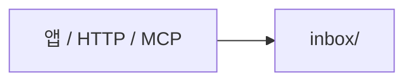

분류기가 메모를 읽고 도메인 하나를 고릅니다.

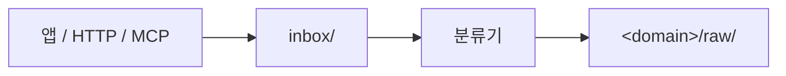

도메인마다 작업을 하나씩 순서대로 처리합니다. 매번 `claude -p`가 `wiki/` 페이지를 고치고, 게이트웨이가 log.md에 한 줄을 남기고 커밋합니다.

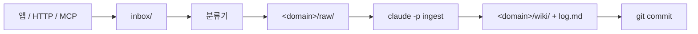

이 흐름과 이 흐름을 지키는 장치는 두 저장소가 같습니다. 도메인별 직렬 처리, inflight 마커, 재시도 3회, `.gateway/lock`, 사진 원본은 커밋하지 않는 `_originals/`가 그런 장치입니다. llmwiki-app에서 P0 이후에 생긴 기능도 dotoriwiki에 손으로 옮겼습니다. 채팅 세션, 사진과 EXIF, Claude Code 플러그인이 그것이고, `5d47cf7`까지 반영했습니다.

## 바뀐 것 1. 위키의 설정이 코드에서 `dotoriwiki.yaml`로

llmwiki-app은 위키에 대한 사실을 네 곳에서 따로 알아냈습니다.

| 사실 | llmwiki-app이 알아내던 곳 |
| --- | --- |
| 도메인 목록 | 루트 `CLAUDE.md`의 `도메인 목록` 표. 게이트웨이가 이 한국어 제목을 찾아 읽었습니다 |
| 페이지 종류 | 도메인 `CLAUDE.md`의 `페이지 종류` 표 |
| 분류 실패 시 갈 곳 | `src/main.ts`의 `fallbackDomain: '일상'` |
| 피드가 들어갈 도메인과 시간대 | `src/feeds.ts`의 `'개발소식지식베이스'`, `'Asia/Seoul'`. `mcp.ts`에도 시간대가 따로 있었습니다 |
| 도메인별 모델 | `models.json`의 `edit.byDomain`. 도메인 이름을 키로 썼습니다 |

그래서 다른 사람이 쓰려면 한국어 제목을 똑같이 맞추고, `일상` 폴더를 만들고, 코드를 고쳐야 했습니다.

dotoriwiki에서는 이 사실이 모두 위키 루트의 `dotoriwiki.yaml` 한 파일에 있습니다.

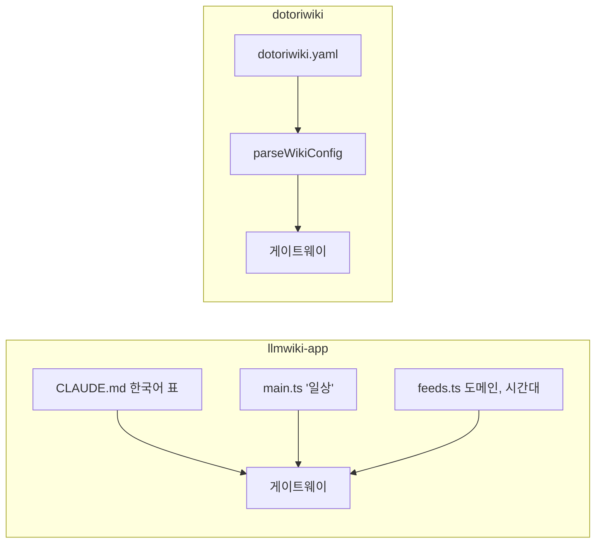

이 파일은 요청마다 다시 읽습니다. 그래서 고치면 재시작 없이 바로 반영됩니다. 파일이 잘못되면 게이트웨이는 죽지 않고 멈춤(paused) 상태가 됩니다. 메모는 계속 `inbox/`에 받고, 분류와 ingest만 쉬고, `/status`가 고칠 키를 하나씩 알려줍니다. 사용자가 손으로 고친 설정은 게이트웨이가 `manual(config)`로 커밋합니다.

모델 선택은 도메인 이름 대신 프로필 이름을 씁니다. `models.json`에 `edit.profiles`를 두고, 도메인이 `model_profile`로 그중 하나를 고릅니다. 도메인 이름은 위키의 사실이고 모델은 머신의 사실이라서, 두 파일이 서로의 이름을 알 필요가 없게 한 것입니다.

설계와 근거는 `docs/design/wiki-config.md`에 있습니다. 작성자 위키처럼 옛 표를 쓰는 위키는 `scripts/migrate-config.ts`로 한 번 변환합니다.

## 바뀐 것 2. 한국어가 코드에서 언어별 파일로

llmwiki-app의 `src/`에는 한국어 줄이 13개 파일에 113줄 있었습니다. 프롬프트, index.md 제목, 커밋 메시지, log.md 단어가 모두 코드 안의 한국어 문자열이었습니다. 영어 사용자가 써도 모든 출력이 한국어로 나왔습니다.

dotoriwiki는 이 글자를 두 종류로 나눴습니다.

**사람이나 모델만 읽는 글자.** 프롬프트, index.md, `_review.md`, 커밋 메시지, 자막 sidecar, 피드 메모가 여기에 속합니다. 이 글자는 `src/wiki/text.ko.ts`와 `text.en.ts`로 옮겼습니다. 둘 다 `Text` 타입을 따르기 때문에 번역이 빠지면 `tsc`가 실패합니다. 위키의 `locale`이 어느 쪽을 쓸지 정합니다.

**코드가 다시 읽는 글자.** log.md의 `실패 1/3`, `포기 3/3`, `새 페이지` 같은 단어입니다. log.md는 기록이면서 게이트웨이의 상태 저장소입니다. 게이트웨이는 메모의 줄을 다시 읽어 그 메모가 처리됐는지 계산합니다. 그래서 이 단어는 번역 파일에 두지 않고 파서 옆 `LEDGER_WORDS`에 둡니다.

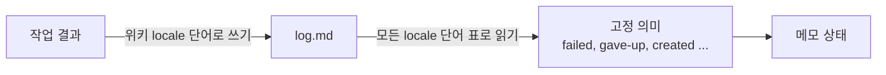

쓸 때는 그 위키의 언어 하나로 씁니다. 읽을 때는 모든 언어의 단어를 담은 표 하나로 읽습니다. 그래서 한국어 위키의 log.md는 llmwiki-app이 쓰던 것과 바이트 단위로 같습니다. 작성자 위키의 작업 305개를 옛 파서와 새 파서로 읽었을 때 결과가 다른 작업은 0개였습니다.

모델의 판정도 바뀌었습니다. 예전에는 모델이 `새 페이지` 같은 한국어로 답했고, 그 글자가 그대로 log.md와 앱 화면에 갔습니다. 지금은 `created`, `updated`, `conflict`, `unchanged` 중 하나로 답하고, 목록 밖의 답은 그 시도를 실패로 처리합니다. 앱 응답에는 화면용 `verdict` 글자를 그대로 두고 `verdict_id`를 더했습니다.

`src/`에 남은 한국어는 17줄입니다. 읽기 표의 한국어 단어, 메모 링크 라벨, 주석의 예시 이름이 전부입니다. 설계는 `docs/design/locale.md`에 있습니다.

## 바뀐 것 3. 위키를 만드는 방법

llmwiki-app에는 위키를 새로 만드는 방법이 없었습니다. 작성자의 위키가 이미 있었고, 설치 스크립트 `install-launchd.sh`가 그 경로를 기본값으로 가정했습니다. 테스트는 테스트 전용 fixture 위키를 썼습니다.

dotoriwiki는 프리셋에서 시작합니다.

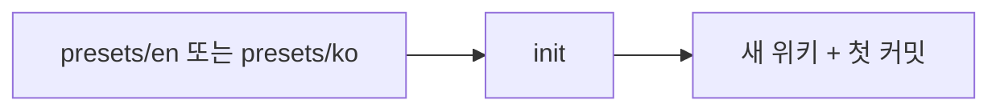

`init`은 프리셋을 복사하고, 시간대를 이 머신 값으로 채우고, `git init`과 첫 커밋을 합니다. 그리고 게이트웨이가 쓸 머신 env 파일을 만듭니다.

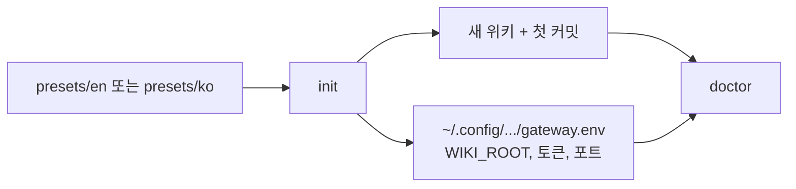

`doctor`는 읽기만 하면서 이 머신과 위키가 준비됐는지 점검합니다. Node, git, env 파일, 위키 설정, 도메인 `CLAUDE.md`, `models.json`, `claude` CLI, 사진 축소 도구를 봅니다. 위키 검사는 게이트웨이가 위키를 열 때(`openWiki`) 하는 검사와 같은 코드(`checkWiki`)입니다. 그래서 두 검사가 서로 다른 판정을 내리지 않습니다.

프리셋은 테스트 fixture이기도 합니다. 테스트가 프리셋으로 위키를 만들기 때문에, 프리셋이 깨지면 테스트가 먼저 실패합니다. 진짜 `claude`를 쓰는 `scripts/e2e.ts`도 이제 작성자 위키가 아니라 `init`으로 새로 만든 위키에서 돕니다.

## 바뀐 것 4. 머신 설정이 한 곳으로

코드, 위키, 머신 설정이 서로 다른 곳에 사는 구조는 llmwiki-app에도 있었습니다. 다만 머신 설정의 경로와 규칙이 `main.ts`, `pair.ts`, 설치 스크립트에 흩어져 있었습니다.

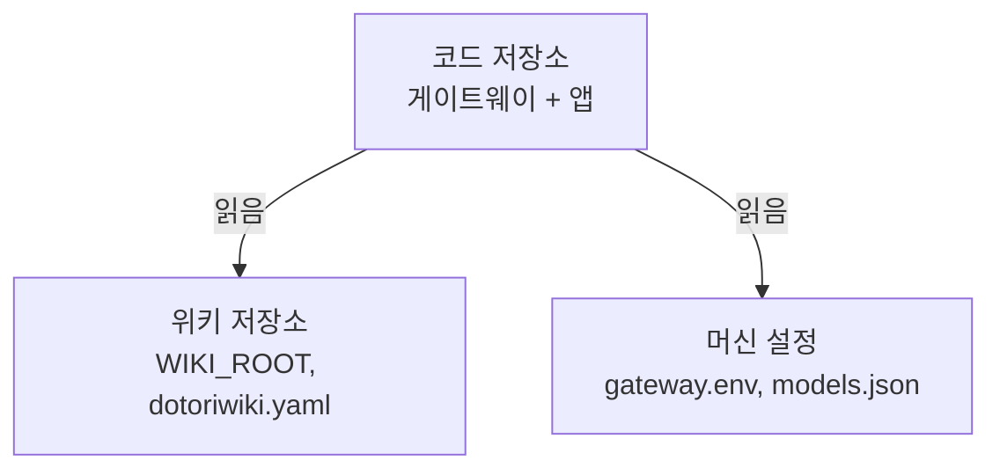

dotoriwiki는 머신 쪽 규칙을 `src/machine.ts` 하나에 모았습니다. env 파일 경로, `loadConfig`, env 파일 형식, 게이트웨이 커밋 작성자가 여기에 있습니다. 토큰, 포트, 실행 파일 경로는 위키에 절대 들어가지 않습니다. 위키는 git으로 다른 머신에 옮겨도 그대로 동작해야 하기 때문입니다.

## 파일 지도

| dotoriwiki에 새로 생긴 것 | 하는 일 |
| --- | --- |
| `src/wiki/config.ts` | `dotoriwiki.yaml`을 `WikiConfig`로 파싱하고 문제를 모두 모아 알려줌 |
| `src/wiki/text.ts`, `text.ko.ts`, `text.en.ts` | 사람과 모델이 읽는 글자의 언어별 템플릿 |
| `src/wiki/ledger.ts`의 `LEDGER_WORDS` | 코드가 다시 읽는 log.md 단어. 배포 후 바꾸지 않음 |
| `src/machine.ts` | 머신 설정의 경로와 형식 |
| `src/init.ts`, `src/doctor.ts`, `src/cli.ts` | 위키 만들기와 점검 |
| `src/install.ts`, `src/service.ts`, `src/pair.ts` | 서비스 설치와 제거, plist와 systemd unit 생성, 폰 연결 QR |
| `presets/en`, `presets/ko` | 새 위키의 출발점이자 테스트 fixture |
| `scripts/migrate-config.ts` | 옛 표를 `dotoriwiki.yaml`로 한 번 변환 |
| `scripts/ledger-audit.ts`, `legacy-ledger.ts` | 옛 파서와 새 파서가 같은 위키를 같게 읽는지 확인 |
| `scripts/check-private.ts` | 개인 정보 패턴이 저장소와 기록에 없는지 확인 |
| `docs/design/`, `docs/plan.md`, `docs/cli.md` | 설계 근거, 단계 계획, 사용법 |
| `app/app.config.ts` | 앱의 패키지 id와 이름을 환경 변수에서 읽음 |
| `app/src/text/` | 앱 화면 글자의 한국어, 영어 표와 언어 선택 |
| `.github/workflows/app.yml` | 앱 테스트와 release APK 빌드 |

| 없어진 것 | 대신 |
| --- | --- |
| `listDomains`, `도메인 목록` 표 읽기 | `dotoriwiki.yaml`의 `domains` |
| `fallbackDomain: '일상'` | `fallback_domain` |
| `feeds.ts`, `mcp.ts`의 `Asia/Seoul`과 피드 도메인 | `time_zone`, `feeds` |
| `models.json`의 `edit.byDomain` | `edit.profiles`와 도메인의 `model_profile` |
| `test/fixture/wiki` | `presets/ko` |
| `scripts/install-launchd.sh`, `scripts/deploy.sh`, `scripts/pair.ts` | `dotoriwiki install`, `uninstall`, `pair` |
| `app/app.json` | `app/app.config.ts` |
| 앱 `wire.ts`의 `src/api.ts` 타입 재수출 | `src/api.ts`의 바이트 사본 |

## 바뀐 것 5. 설치와 실행

llmwiki-app은 코드 저장소를 clone한 자리에서 `node src/main.ts`로 돌았습니다. `install-launchd.sh`가 env 파일을 매번 새로 쓰고, LaunchAgent가 zsh로 그 파일을 `source`한 뒤 게이트웨이를 띄웠습니다. macOS 전용이었고, 다시 설치하면 손으로 넣은 값이 지워졌습니다.

dotoriwiki는 npm 패키지로 설치합니다. 개발할 때는 지금처럼 `.ts`를 그대로 실행하고, `npm pack` 때만 `dist/`로 빌드합니다. Node가 `node_modules` 안의 TypeScript는 실행하지 않기 때문입니다.

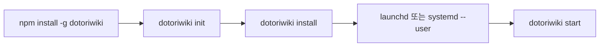

`install`은 env 파일을 덮어쓰지 않고 빠진 키만 더합니다. Tailscale 주소를 CLI로 찾아 `HOST`에 넣고, plist나 systemd unit을 쓴 뒤 서비스를 시작합니다. 여러 번 돌려도 결과가 같습니다. 서비스는 `dotoriwiki start`를 실행하고, `start`가 env 파일을 직접 읽습니다. 그래서 셸 파일을 `source`하는 단계가 없습니다. `pair`는 폰 연결용 QR을 출력합니다.

이름도 이때 바뀌었습니다. 설정 디렉터리는 `~/.config/dotoriwiki`, 채팅은 `~/.local/share/dotoriwiki/chats`, 서비스 이름은 `dotoriwiki.gateway`, MCP 서버와 플러그인은 `dotoriwiki`입니다. 옛 경로를 읽는 호환 코드는 없습니다. 옛 env 파일만 있는 머신에서는 `doctor`가 옮기는 명령을 알려줍니다.

## 바뀐 것 6. Claude 결제를 고를 수 있게

llmwiki-app은 `claude -p`를 언제나 로그인한 구독으로 돌렸습니다. `claude`는 환경에 `ANTHROPIC_API_KEY`가 있으면 구독 대신 API로 과금합니다. 그래서 게이트웨이는 셸에 키가 있어도 claude 환경에서 그 키를 지웠습니다. 구독이 없는 사람은 쓸 방법이 없었습니다.

dotoriwiki는 env 파일의 `CLAUDE_BILLING`으로 고릅니다.

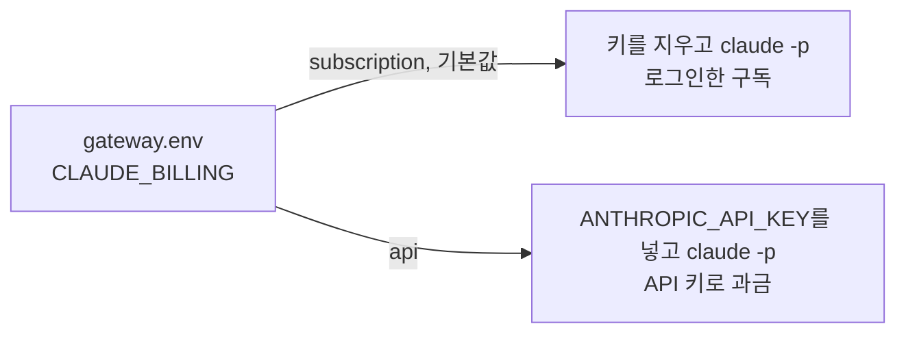

기본값 `subscription`은 llmwiki-app과 같습니다. 셸에 있던 키는 여전히 claude에 닿지 않습니다. `api`는 env 파일의 `ANTHROPIC_API_KEY`를 claude 환경에 넣고, 로그인이 필요 없습니다. `api`인데 키가 없으면 설정 오류라서 `start`, `doctor`, `install`이 멈추고 키를 넣으라고 알려 줍니다. `doctor`는 어느 쪽으로 과금되는지 보여 주지만 키는 출력하지 않습니다. `install`이 쓰는 서비스 파일에는 env 파일 경로만 있고 키는 없습니다. codex는 두 경우 모두 자기 로그인을 씁니다.

## 바뀐 것 7. 앱이 저장소 밖에서도 빌드되게

llmwiki-app의 앱은 작성자의 폰 한 대를 위한 앱이었습니다. 패키지 id와 앱 이름이 `app.json`에 고정돼 있었고, 화면 글자는 모두 한국어였습니다. 앱의 `wire.ts`는 게이트웨이의 `src/api.ts`에서 타입을 다시 내보냈습니다. 그래서 앱은 저장소 전체가 있어야 빌드됐고, APK는 작성자의 Mac에서 손으로 만들었습니다.

dotoriwiki는 네 가지를 바꿨습니다.

**패키지 id와 이름은 환경 변수로.** `app/app.json` 대신 `app/app.config.ts`가 `DOTORIWIKI_APP_ID`(기본 `dev.dotoriwiki.app`)와 `DOTORIWIKI_APP_NAME`(기본 `Dotori`, 한국어 폰에서는 도토리)을 읽습니다. 각자 빌드한 앱이 다른 사람의 앱 위에 설치되지 않습니다. 딥 링크 scheme은 `dotoriwiki`입니다.

**화면 글자는 언어별 파일로.** 앱이 보여 주는 문장은 모두 `app/src/text/ko.ts`와 `en.ts`에 있습니다. 앱은 시작할 때 폰의 언어를 한 번 읽고, `ko`로 시작하는 언어면 한국어, 나머지는 영어를 씁니다. `en`의 타입이 `typeof ko`라서 키가 빠지면 `tsc`가 실패하고, 영어 문장에 한글이 섞이면 `text.test.ts`가 실패합니다. 판정은 게이트웨이가 보낸 `verdict_id`로 폰의 언어에 맞게 씁니다. `verdict_id`가 없는 옛 게이트웨이와 옛 기록에는 받은 `verdict` 글자를 그대로 보여 줍니다.

**wire 타입은 바이트 사본으로.** `app/src/lib/wire.ts`는 `src/api.ts`를 그대로 복사한 파일입니다. 그래서 `app/`만 있어도 빌드됩니다. 두 파일이 다르면 게이트웨이의 `test/app-wire.test.ts`와 앱 CI가 실패합니다. 계약을 바꿀 때는 `src/api.ts`를 고치고 복사합니다.

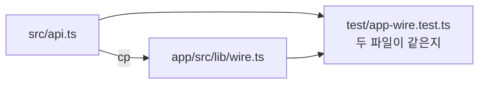

**APK는 CI에서.** `.github/workflows/app.yml`이 변경마다 타입 검사와 테스트를 돌리고, main과 태그에서 release APK를 빌드합니다. 서명 secret이 있으면 그 키로, 없으면 debug 키로 서명합니다. `v*` 태그를 달면 그 태그의 GitHub Release에 APK와 sha256을 올립니다.

## 남은 차이

두 저장소의 관계는 P8에서 끝납니다. 그때까지 llmwiki-app에 생기는 변경은 dotoriwiki로 손으로 옮깁니다. P8에서 작성자의 실제 위키가 dotoriwiki 게이트웨이로 넘어갑니다. 한국어 log.md가 바이트 단위로 같기 때문에, 그 과정에서 두 게이트웨이가 같은 위키를 번갈아 읽어도 상태가 어긋나지 않습니다.
